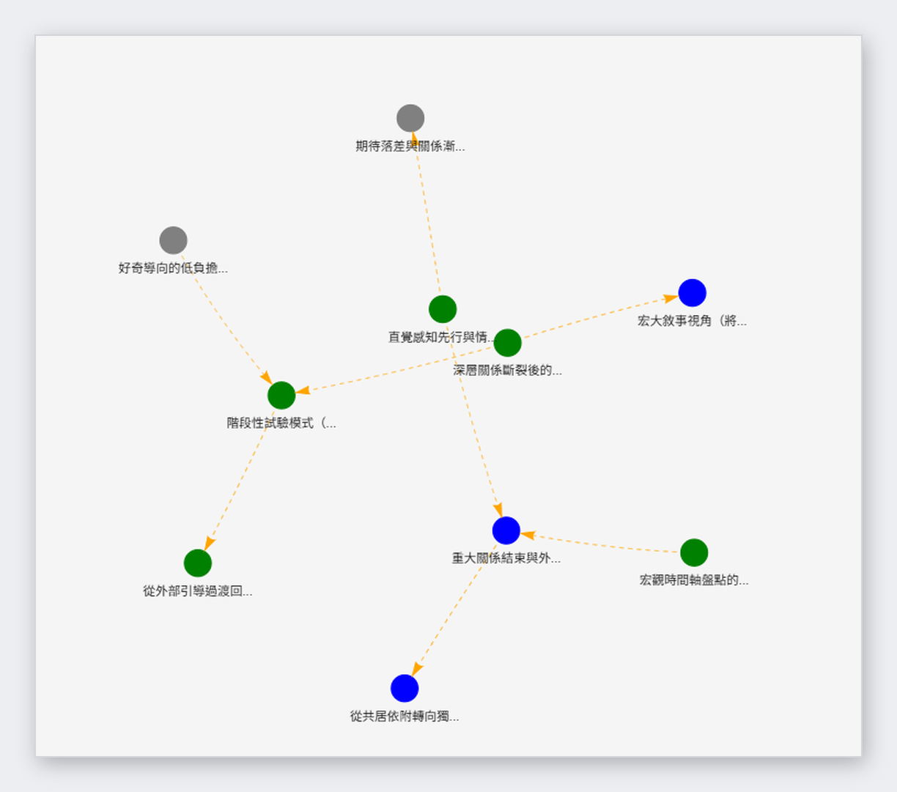
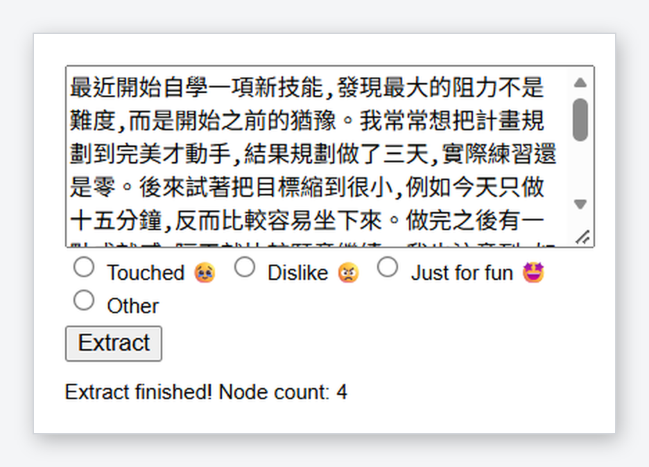
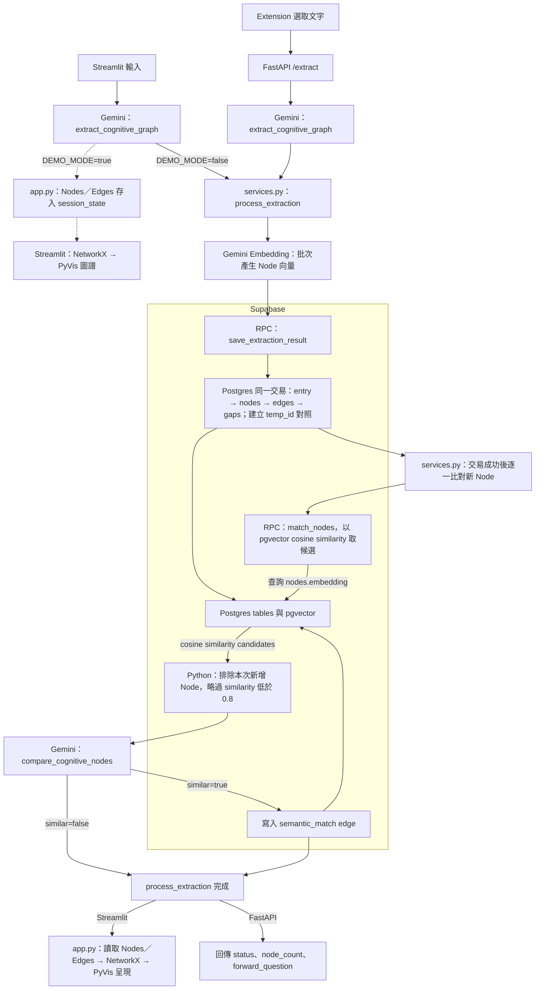

# Cognitive Graph

**Live demo:** [cognitivegraph-demo.streamlit.app](https://cognitivegraph-demo.streamlit.app/)（閒置後首次開啟，需按一下按鈕喚醒，約需等待數十秒）

## Elevator Pitch

零散的日記與網頁閱讀筆記，常讓跨時間出現的想法彼此斷開。Cognitive Graph 使用 Gemini 從文字中萃取思維節點與關係，並把不同時間、語意相近的認知模式連成可互動的圖譜。

### Demo

示範站以 `DEMO_MODE` 執行，輸入內容只存在當次 session，不會寫入資料庫。



從文字萃取出的認知圖譜，節點為概念，箭頭為關係方向。



Chrome／Edge 擴充套件，選取網頁文字後選填 Reaction 並按 Extract，完成後顯示處理結果。

## What it does

- **輸入**：在 Streamlit 網頁版貼上自由文字，或在 Chrome／Edge 擴充套件中擷取網頁選取文字。
- **Nodes**：辨識認知模式或重要概念，並標記為 `active`、`pending` 或 `recurring`。
- **Edges**：描述 Nodes 之間的方向、強度與關係理由。
- **Gaps**：記錄文字中提到但尚未說完的線索。
- **Forward Question**：提出一個值得接續探索的問題。
- **Reaction**：Chrome／Edge 擴充套件 popup 提供 Touched（`resonate`）、Dislike（`repel`）、Just for fun（`curious`）、Other（`other`）四種選項與選填說明，隨 entry 一起存入資料庫。只有擴充套件提供此輸入，Streamlit 沒有；Reaction 目前只儲存，不參與 Gemini 萃取或圖譜判斷。
- **雙入口、共用核心**：Streamlit 由 [app.py](app.py) 呼叫 [services.py](services.py)；擴充套件透過 [api.py](api.py) 的 FastAPI `/extract` endpoint 呼叫同一個 `process_extraction`。兩個入口共用儲存與語意配對流程。

## 系統架構與資料流



正式資料流程中，`process_extraction` 先批次取得 Embedding，再呼叫交易函式；交易完成後才執行語意配對。`DEMO_MODE=true` 時，Streamlit 走虛線旁支，將萃取結果存於 `session_state` 並呈現圖譜，不進入 Embedding、資料庫交易或語意配對流程。Extension 的 API 回傳處理摘要；圖譜呈現由 Streamlit 執行。

## Engineering Highlights

### 1. 兩階段語意配對

[services.py](services.py) 的 `process_extraction` 以 pgvector 計算 cosine similarity，取得最多 2 個候選；`schema.sql` 未為 `nodes.embedding` 建立向量索引（只有 primary key）。低於 `0.8` 的候選會略過，其餘交由 [extract.py](extract.py) 的 `compare_cognitive_nodes` 使用 Gemini 判斷。只有 `similar=true` 才寫入語意 Edge。

### 2. 單次 Extraction 的資料庫交易

[database.py](database.py) 的 `save_extraction_transaction` 以一次 RPC 呼叫 [schema.sql](schema.sql) 的 `save_extraction_result`。Function 在同一交易內依序寫入 entry、nodes、edges、gaps；Gemini 輸出的節點使用暫時 ID（`temp_id`），插入 nodes 時建立 `temp_id` 到實際資料庫 ID 的對照表，再用此對照寫入 edges 與 gaps。任何一步失敗，整筆交易回滾。

### 3. 共用服務與示範資料隔離

[app.py](app.py) 與 [api.py](api.py) 都使用 [services.py](services.py) 的 `process_extraction`，讓正式資料儲存及語意比對流程由同一處處理；在 [app.py](app.py) 的 `save_extraction_result()` helper 中，`DEMO_MODE=true` 分支會將 Nodes／Edges 存入 `st.session_state`，不呼叫 `process_extraction` 或資料庫。這讓 Streamlit 示範輸入不會寫入正式資料庫，而資料只保留在該次 Streamlit session；此模式不套用於 FastAPI。

## Quick Start

1. 安裝相依套件：

   ```bash
   pip install -r requirements.txt
   ```

2. 在專案根目錄建立 `.env`：

   ```env
   GEMINI_API_KEY=your_gemini_api_key
   SUPABASE_URL=your_supabase_project_url
   SUPABASE_KEY=your_supabase_service_role_key
   ```

3. 在 Supabase SQL Editor 執行 `schema.sql`。
4. 啟動 Streamlit：

   ```bash
   streamlit run app.py
   ```

<details>
<summary>Render 部署注意事項</summary>

`requirements.txt` 的部分 pinned dependency versions 在 Python 3.12 下才能順利解析。部署到 Render 等平台時，設定 `PYTHON_VERSION=3.12.10`，並提供 `GEMINI_API_KEY`、`SUPABASE_URL` 與 `SUPABASE_KEY`。

</details>

<details>
<summary>本地端 API 測試</summary>

啟動 FastAPI：

```bash
uvicorn api:app --reload
```

在 PowerShell 呼叫本地 `/extract` endpoint：

```powershell
Invoke-RestMethod -Uri "http://127.0.0.1:8000/extract" -Method Post -ContentType "application/json" -Body '{"text":"想測試的文字"}'
```

</details>

<details>
<summary>載入 Chrome／Edge 擴充套件</summary>

1. 前往 `chrome://extensions` 或 `edge://extensions`，開啟 **Developer mode**，按 **Load unpacked** 並選取 `extension/`。
2. 預設的 `extension/popup.js` 會呼叫 Render API。若要測試本地 API，將其中的 `fetch` URL 改為 `http://127.0.0.1:8000/extract`。
3. 在網頁選取文字、開啟擴充套件並按 **Extract**。修改 `extension/` 內容後，重新載入擴充套件並重新整理正在測試的網頁分頁。

</details>

## Status 與 Known Limitations

Work in progress — personal project and portfolio piece.

Core pipeline (extraction → embedding → atomic transaction save → semantic matching → graph rendering) is built and has been tested across varied inputs (long-form transcripts, forum posts, multilingual text). The FastAPI backend is deployed (Render) and the browser extension calls it live end-to-end.

Known limitation: the extension's popup UI doesn't persist state — closing or unfocusing it while extraction is in progress loses the on-screen result, though the extraction itself still completes and saves to the database. Not yet fixed; tracked as a future improvement.
